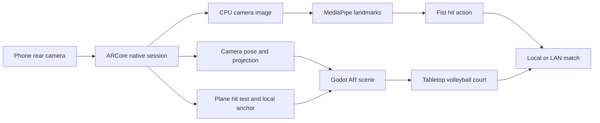

# Mobile AR on your Samsung Galaxy M31s

**Current update: version 2.3 (code 5).** Adds **Place without scan** for immediate approximate placement, accepts the full detected plane extents, and declares high-rate motion sensor permission. The previous 2.2 update fixed the blank camera. This build was installed and its live color preview verified on your actual M31s over USB. Keep **Camera: Safe** selected initially. The prior blank screen was a native-method lookup bug, not something fixed by repeatedly changing the lighting. Safe mode uses a compatible color texture with encoding on an independent worker; **Camera: Fast** selects raw YUV. Hand hits remain OFF until you enable them.

The center ring is an aim guide: keep the rear lens uncovered, scan a textured horizontal surface gently and tap Place court when ready. ARCore's light/features messages describe tracking conditions; they can still occur if the lens is covered, the surface is blank or movement is too fast. The preview should remain visible while scanning.

Start with **Hand hits: OFF** and **Camera: Safe**. Turn off **Power saving** under Settings ? Battery and device care ? Battery before testing AR. The connected phone was observed with Power saving enabled and motion sensors updating at 6.25 Hz; its ARCore logs showed camera frames ahead of available IMU data. Disabling Power saving and restarting did not restore the sensor rate during testing; it is not a confirmed fix.

Hold the rear camera 40?80 cm above a well-lit textured table or floor. Move the whole phone slowly sideways and forward 20?30 cm; do not only rotate it in place. Try a printed sheet or textured book on a glossy/blank surface. When the ring turns green, tap **Place court**. Placement remains queued until a valid horizontal surface is found; **Cancel placement** cancels it. The ring is an aiming guide, not a button, and disappears after placement. **Move court** lets you reposition.

If the ring stays yellow, aim at the floor or table and tap **Place without scan**. It creates a horizontal court about 1.2 metres along the camera's aiming direction, even without a detected surface. This is approximate placement: it does not measure the real floor height and may float, drift or slide when tracking is poor. Keep the phone roughly in place for the easiest demo. Aim slightly higher/lower and tap it again to reposition. **Move court** returns to detected-surface placement.

**Phone hand tracking controls hits only.** Use the touch direction buttons to move, JUMP to jump, and an open-palm ? closed-fist gesture to hit. Palm movement is only a desktop webcam control.

Use touch movement and **HIT** first. After placement, turn **Hand hits: ON** to try closed-fist hits with the rear camera. Reopen your palm between fists. Keep hand hits off if inference reduces performance.

**The current APK is `build/NeonVolleyAR.apk`, version 2.3 (code 5).** It is already installed on the connected M31s. The high-rate sensor permission restored motion subscriptions to 200 Hz, and ARCore now reports a detected horizontal surface and valid center hit. For another installation, copy it to Downloads, open it using My Files and install the update. You do not need to rebuild. The actual phone now shows live color camera imagery and about 27?28 HUD FPS in captured frames; approximate placement and detected-surface anchoring are now verified, while phone hand gestures have not yet been verified. The older optimization/build notes in VALIDATION.md are historical.

Your Galaxy M31s appears on [Google's official ARCore-supported device list](https://developers.google.com/ar/devices). The project already contains its native ARCore integration; you do not need Unity, an ARCore Cloud project or an API key for this local tabletop demo. Both approximate placement and detected-surface anchoring are verified on your phone; camera alignment during extended movement and phone hand gameplay still need verification.

## 1. Prepare the phone while the PC builds

1. Open **Settings > About phone > Software information**.
2. Tap **Build number seven times** and enter your phone PIN if requested.
3. Return to Settings, open **Developer options**, and enable **USB debugging**.
4. Connect the phone to the PC with a **USB data cable**. Unlock the phone and accept **Allow USB debugging** for your own PC. If necessary choose **File transfer** in the USB notification.
5. Open Google Play on the phone and install/update **Google Play Services for AR**. Keep the phone's software updated.

The Samsung Developer options steps are documented by [Samsung](https://www.samsung.com/us/support/answer/ANS10003430/); the USB authorization prompt is explained in [Android's device setup guide](https://developer.android.com/studio/run/device).

## 2. Build the current volleyball APK

Double-click **Build Android AR.cmd** in this project folder.

The launcher will:

1. Find the bundled Godot/Gradle tools and JDK 17.
2. Install missing Android SDK packages into `.tools/android-sdk` (or use your explicit `ANDROID_HOME`).
3. Show **Google's SDK license prompts**. Read them, and type **y only if you agree**. These require your decision; the assistant has not accepted them for you.
4. Download API 35 platform/build-tools, platform-tools, NDK 28.1 and CMake. The first setup can take a while and requires several GB of free space and internet access.
5. Compile the native ARCore/MediaPipe plugin and copy its AAR into the Godot addon.
6. Configure the bundled editor, export **`build/NeonVolleyAR.apk`**, and verify the APK signature.

Wait for the green **Ready to install** message. If the window reports an error, the build has not finished. Do not install the old `PocketTerrainAR.apk` as a substitute: that is the original terrain demo, without the volleyball changes.

Equivalent PowerShell command:

```powershell
powershell -NoProfile -ExecutionPolicy Bypass -File tools/build_android.ps1 -InstallSdk -ExportApk
```

After the first SDK setup, rebuild more quickly with:

```powershell
powershell -NoProfile -ExecutionPolicy Bypass -File tools/build_android.ps1 -ExportApk
```

The SDK setup and native/Godot export have now completed. The build launcher reuses installed SDK packages, and the native build is limited to two workers with a smaller Java heap. Rebuild only when changing game code or assets.

If a tool or export template is missing on another PC, run:

```powershell
python tools/download_tools.py
python tools/download_android_templates.py
```

The selected toolchain follows [Godot's Android export setup](https://docs.godotengine.org/en/4.5/tutorials/export/exporting_for_android.html). Android Studio is an alternative for installing SDK components, not an additional requirement for the bundled workflow.

## 3. Install and launch

With the phone connected and USB debugging authorized, double-click **Install Android AR.cmd**.

The installer lists connected devices, checks that the phone runs an ARM64 Android OS, installs **NeonVolleyAR.apk** and launches **Neon Volley AR**. Confirm any install request on the phone. Camera permission remains your choice when the app asks.

To check the USB connection without installing:

```powershell
powershell -NoProfile -ExecutionPolicy Bypass -File tools/install_android.ps1 -CheckOnly
```

If multiple devices are connected, select your phone explicitly:

```powershell
powershell -NoProfile -ExecutionPolicy Bypass -File tools/install_android.ps1 -Serial YOUR_DEVICE_SERIAL
```

Alternatively copy `build/NeonVolleyAR.apk` to the phone and open it from My Files. Android may ask you to allow installation from that app. This manual route does not require USB debugging.

## 4. First AR test: use touch before hand gestures

1. Open **Neon Volley AR** and allow **Camera** access. Follow the Google Play Services for AR install/update prompt if one appears, then return to the app.
2. Hold the phone **landscape**. Point its rear camera at a textured table or floor, in good light. Move slowly sideways and in a small arc so ARCore can recognize a horizontal surface.
3. Aim the **center reticle** at the surface. Tap **Place court**. If it says no surface was found, scan longer, aim again and retry. A blank/glossy table is a poor first test; a patterned tablecloth or textured floor works better.
4. The court should appear on the surface. Including stands, it is about **83 by 97 cm** at the current scale. Use a sufficiently large table or the floor.
5. Move the phone around it. The court should stay in the same physical place and change perspective naturally. This is the key mobile AR demonstration.
6. Use the directional pad, **HIT / SERVE**, **JUMP** and **RUN** buttons. Serve against the AI and follow the landing ring to return the ball.
7. Briefly point away, then return to the surface. Tracking loss hides the court; recovery should make it return to the same anchor. Background the app and reopen it to test pause/resume.

Effects start **off** on Android, and 3D resolution is reduced to 60% for a lighter first run. You can use **Effects** to compare the compositor once basic AR is working. The native CPU camera images are capped at roughly 640 pixels wide. No performance result is claimed until the M31s is tested.

If the camera view or perspective looks rotated, keep the phone in landscape, return to the app, and test placement again. Viewport changes and app resume now refresh native display geometry. If it is still wrong, collect the log described below instead of changing projection constants blindly.

## 5. Test phone hand gestures

Phone hand tracking uses the same rear-camera image as ARCore, with on-device MediaPipe landmarks. You do not run the Python/OpenCV webcam launcher on the phone.

1. Place the court and confirm touch HIT works first.
2. Tap **Hand hits: ON**, then show your **whole open palm to the rear camera**, not the selfie camera. Hold the phone in one hand and demonstrate with the other, or ask someone else to make the gesture.
3. Wait for the landmark skeleton. Keep wrist and fingers visible.
4. Show an open palm briefly, then close into a **fist** and hold for about 0.4 seconds. Phone inference is deliberately throttled to protect camera responsiveness. This attempts one serve/hit. Reopen before another hit.
5. A held fist must not repeatedly hit. Removing the hand clears tracking and disarms the gesture until an open palm is seen again.

Movement on the phone uses the touch pad; the desktop webcam's neutral-position movement controller is separate. Both input paths reach the same server-authoritative hit action in multiplayer.

## 6. Join your PC's match

1. Connect the PC and phone to the same private Wi-Fi.
2. Run the desktop demo and click **Host**. Allow Godot through the private Windows firewall if prompted.
3. Run `ipconfig` on the PC and find its Wi-Fi IPv4 address, for example `192.168.1.25`.
4. On the phone, place the AR court, enter that IP in the lobby and tap **Join**. Do not use `127.0.0.1` here; that means the phone itself.
5. The desktop host is teal and the first joining phone is coral. The AI is replaced. Both should show the same ball, scores and avatar appearances.
6. The PC serves first. On the phone move toward the landing ring and use HIT or a fist to return the ball. Demonstrate that scoring changes on both devices.

Traffic uses UDP 7777. Guest Wi-Fi may isolate devices. Shared multiplayer coordinates do not mean shared physical AR anchors: each phone independently places its own court.

## 7. Troubleshooting and logs

| Problem | Action |
| --- | --- |
| SDK licenses are declined or packages missing | Rerun Build Android AR.cmd, review the terms and complete setup if you agree |
| Download timeout / manifest failure | Check internet access or proxy restrictions; rerun the build launcher. Completed SDK packages are reused |
| No phone / `unauthorized` | Unlock it, accept USB debugging, try a data cable/another USB port, then rerun installer |
| Windows does not recognize Samsung USB debugging | Install the [official Samsung USB driver](https://developer.samsung.com/android-usb-driver) if needed |
| `INSTALL_FAILED_UPDATE_INCOMPATIBLE` | The installed app has a different signing key. Manually uninstall the old app only if you are willing to lose its app data, then install the new APK |
| App asks for camera but no AR appears | Allow camera, update Google Play Services for AR, scan a textured horizontal surface and tap Place |
| Permission was denied | Settings > Apps > Neon Volley AR > Permissions > Camera, then reopen the app |
| App crashes before camera | Capture logs; Vulkan/graphics support and native startup must be checked on the actual phone |
| It is slow | Keep Effects off, close background camera apps and test touch gameplay before enabling gestures |
| Fist ignored | Ensure open palm was seen first, court is tracking, it is your turn, and the ball is nearby |

After SDK setup, collect diagnostics from PowerShell:

```powershell
& ./.tools/android-sdk/platform-tools/adb.exe devices
& ./.tools/android-sdk/platform-tools/adb.exe logcat -d -v time > build/android-logcat.txt
```

If using another SDK, replace `.tools/android-sdk` with your SDK path. Share the error near `PocketAR`, `ARCore`, `Godot`, `AndroidRuntime` or `Vulkan`, plus what happened immediately before it.

## How AR is implemented in this project



| File | What it implements |
| --- | --- |
| `native/pocket-ar/.../PocketARPlugin.kt` | Permission/ARCore installation, session lifecycle, EGL camera texture, plane hit test, anchor, display geometry, CPU camera image and landmarks |
| `addons/pocket_ar/export_plugin.gd` | Includes the plugin AAR and Maven dependencies in the Android export |
| `scripts/main.gd` | Uses camera pose/projection, maps the background image, applies the local anchor and scale, renders hand overlay and recognizes fist hits |
| `scripts/volleyball.gd` | Pauses local authoritative play while the AR court is unplaced or tracking is lost |
| `tools/build_android.ps1` | SDK setup, native compilation, Godot export and APK signature verification |
| `tools/install_android.ps1` | Device selection, install and app launch |

Current verification: desktop gameplay/network and synthetic AR tests passed, including stale/error-frame hiding and recovery. Native source changes, phone tracking, camera alignment, pause/resume and performance still require a successful Android build and physical-device testing.
